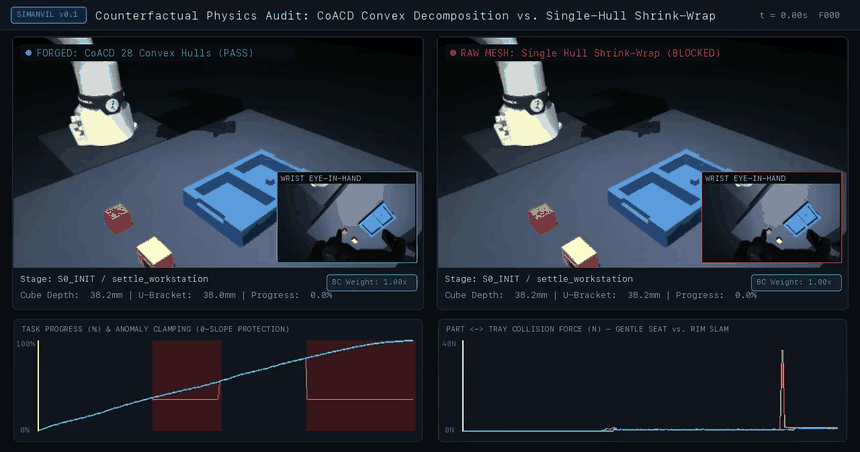
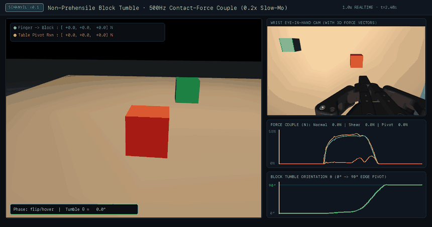
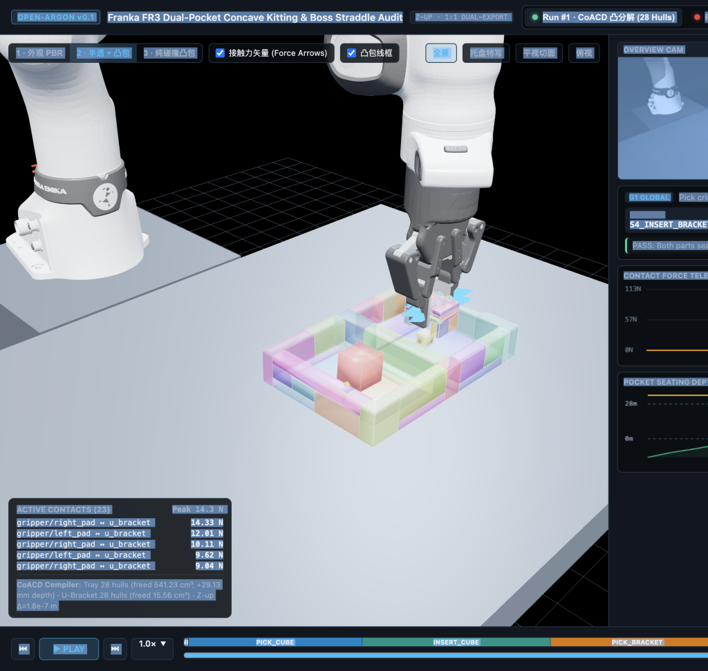
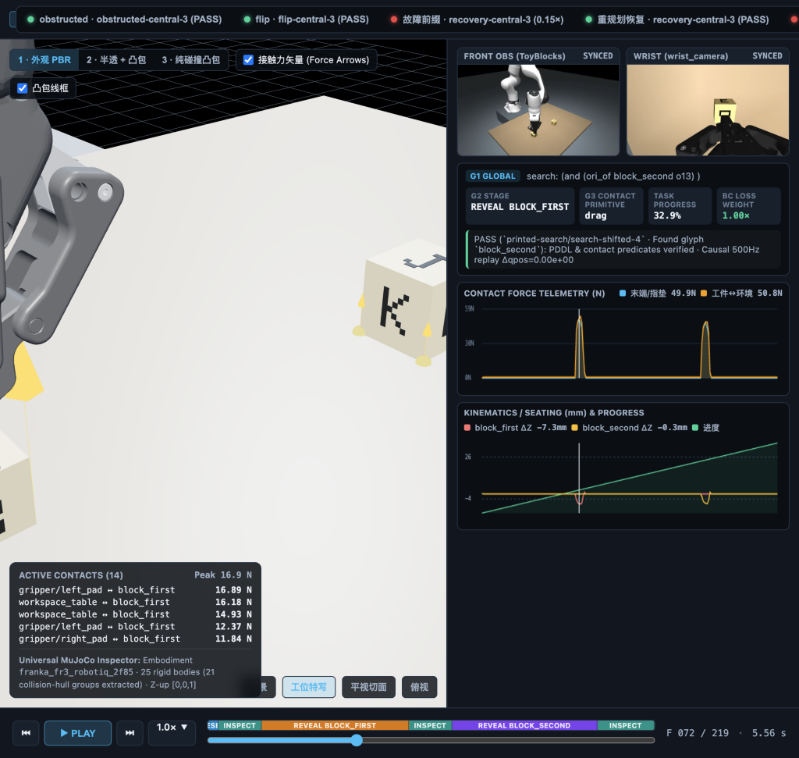

# SimAnvil

<p align="left">
  <strong>The Digital Physics Anvil for Embodied AI — Forge concave assets, inspect 3D contact mechanics, and assay quality-weighted VLA datasets.</strong>
  <br/>
  <a href="README.md">English</a> · <a href="README_zh.md">简体中文</a> · <a href="docs/assets/simanvil_showcase.mp4">Kitting Audit Video (.mp4)</a> · <a href="docs/assets/toyblocks_flip_forces.mp4">500Hz Flip Force Video (.mp4)</a>
</p>



### 500 Hz Non-Prehensile Edge-Pivot Tumble & 3D Contact-Force Couple (`0.2×` Slow-Mo)



---

## Why SimAnvil?

Scaling synthetic MuJoCo data for Vision-Language-Action (VLA) policies hits three recurring failure modes that plain RGB rollout videos hide:

1. **The Shrink-Wrap Trap**: Dropping raw `.obj` / `.glb` meshes into MuJoCo wraps concave bins, bowls, and brackets in a single outer convex hull—sealing cavities behind invisible air-walls while Blender's default Y-up `.glb` export silently misaligns WebGL visuals from Z-up physics.
2. **Silent Reward Hacking**: Scripted or RL rollouts often look plausible in RGB while relying on state teleportation, weld-assisted grasps, or `>100 N` penetration spikes.
3. **Poisoned Imitation Trajectories**: Slip/retry loops, IK singularities, and rim-collision tails degrade policy learning if trained at `1.0×` weight, yet dropping entire episodes wastes clean prefix data and breaks action-chunk temporal continuity.

**`simanvil`** provides a **zero-LLM digital physics & dataset core** (`src/simanvil/`) paired with **Agent Skills** (`skills/`), turning both terminal pipelines and AI coding agents into a rigorous physical compilation loop.

---

## Interactive 3D Session Viewer (`simanvil inspect`)

Every trajectory compiles into a self-contained, zero-backend static HTML workbench (`Z-up [0,0,1]`, `[w,x,y,z] → [x,y,z,w]` quaternion sync, live `mj_contactForce` 3D vectors, `1/2/3` PBR ↔ Convex Hull toggles, and `GOP=1` frame-exact dual camera scrubbing):

| Concave Kitting (28 CoACD Hulls + 3D Force Vectors) | Non-Prehensile Finger-Drag & 5×7 Glyph Inspection |
| :---: | :---: |
|  |  |

---

## Dual-Interface Architecture: CLI for Humans, `skills/` for Agents

```text
  Raw Mesh (.glb/.obj)             MuJoCo Physics Loop                VLA Training (LeRobot / OpenPI)
          │                                │                                        ▲
          ▼                                ▼                                        │
  ┌───────────────┐              ┌───────────────────┐                    ┌───────────────────┐
  │ simanvil forge│ ──MjSpec───► │  AnvilRecorder    │ ──.npz + Δqpos=0─► │  simanvil assay   │
  │ Blender Z-up  │              │  (state, controls,│        │           │  0-slope clamp +  │
  │ + CoACD +     │              │   phase @ 500Hz)  │        │           │  0.15x BC weight  │
  │ Smoke Audit   │              └───────────────────┘        ▼           │  -> LeRobot v3    │
  └───────────────┘                                  ┌──────────────────┐ └───────────────────┘
                                                     │ simanvil inspect │
                                                     │ 3D Force Arrows  │
                                                     │ + Hull Overlays  │
                                                     └──────────────────┘
```

- **For Engineers & CI Clusters**: `src/simanvil/` has **zero LLM SDK dependencies**—deterministic geometry, physics verification, and dataset compilation run offline anywhere.
- **For AI Coding Agents (Antigravity / Claude Code / Cursor / Codex)**: Mount [`plugin.json`](plugin.json) or [`skills/`](skills/) so the host multimodal agent uses `simanvil` to forge concave parts, inspect browser contact sheets for Reward Hacking, and iterate on controllers.

---

## Installation

```bash
# Core package (Forge + Trace + Inspect — lightweight, no PyTorch required)
pip install -e .

# Optional: LeRobot v3 dataset assaying & PyAV tensor readback verification
pip install -e ".[lerobot,dev]"
```

*`simanvil forge` invokes Headless Blender 4.x (`/Applications/Blender.app` on macOS, `blender` on `PATH`, or `BLENDER_BIN=/path/to/Blender`).*

---

## 60-Second Quickstart

### 1. Run the Self-Contained CoACD vs. Shrink-Wrap Benchmark

No external robot asset downloads required:

```bash
python examples/quickstart_kitting.py
simanvil serve --dir outputs/quickstart/session --port 8895
# Open http://127.0.0.1:8895/index.html (keys: Space play/pause, 1/2/3 hull modes, F force vectors)
```

### 2. Record Any Existing MuJoCo Loop in 4 Lines

`AnvilRecorder` never stores bulky RGB arrays during stepping—saving ~200 KB `(state, controls, phase)` traces that deterministically reconstruct multi-view RGB and 3D contact wrenches offline with `Δqpos == 0` causal replay verification:

```python
from pathlib import Path
from simanvil import AnvilRecorder

rec = AnvilRecorder(model, data, task="Open cabinet drawer", robot_type="my_arm", fps=25)
for step in range(500):
    rec.step(ctrl, phase="S1_PULL/pull_handle")  # use 'retry' / 'fault' tokens to auto-flag anomalies
rec.save(Path("outputs/runs/ep_001.npz"), passed=True)
```

Then inspect in 3D and assay into a quality-weighted **LeRobot v3** dataset in one command:

```bash
simanvil inspect outputs/runs/ep_001.npz \
  --output outputs/session \
  --assay-out outputs/lerobot_v3
```

### 3. Train VLA / Imitation Policies with Frame-Level `sample_weight`

```python
per_frame_loss = criterion(pred_action, batch["action"])  # (B, ...)
weights = batch["sample_weight"].view(-1, *([1] * (per_frame_loss.ndim - 1)))
loss = (per_frame_loss * weights).sum() / weights.sum().clamp_min(1e-6)
```

---

## Physical & Engineering Invariants

| Contract | Guarantee in `simanvil` |
| :--- | :--- |
| **Single-Source Z-Up Alignment** | Headless Blender normalizes `ORIGIN_CENTER_OF_VOLUME` and exports `visual.glb` (`export_yup=False`) + `collision_source.obj` (`Y-forward, Z-up`), asserting bounding-box delta `< 1e-4 m` (`~0.2 µm` typical). |
| **MuJoCo Layer Convention** | `group="2"` visual (`contype=0, conaffinity=0`), `group="3"` CoACD convex hulls (`condim=4` torsional friction), `group="4"` reference `<site>`s. |
| **Quaternion & Pose Sync** | `THREE.Object3D.DefaultUp.set(0, 0, 1)` + strict MuJoCo `[w, x, y, z]` → Three.js `Quaternion(x, y, z, w)` body synchronization. |
| **Causal Replay Verification** | Re-integrates native high-frequency `controls` from `state[0]` via `mj_step` and records endpoint `max_abs_qpos_err`. |
| **Zero-Lag Frame Scrubbing & Readback** | `PyAV` all-intra (`GOP=1`) H.264 camera streams for instant frame-stepping; `LeRobot v3` exports verify decoded RGB `MAE < 0.05` before publishing. |
| **Zero-Intrusion Benchmark Adapters** | Plug external benchmarks via `register_episode_adapter` without touching core code (see [`examples/inspect_toyblocks_dir.py`](examples/inspect_toyblocks_dir.py)). |

---

## Bundled Agent Skills

- [`skills/simanvil-forge/SKILL.md`](skills/simanvil-forge/SKILL.md) — Concavity threshold tuning, articulated part splitting, and `attach_forged_asset(MjSpec)` rules.
- [`skills/simanvil-inspect/SKILL.md`](skills/simanvil-inspect/SKILL.md) — Anti-Reward-Hacking visual & contact-force audit checklist.
- [`skills/simanvil-assay/SKILL.md`](skills/simanvil-assay/SKILL.md) — 4-tier hindsight relabeling (`G1–G3`) and anomaly policy selection (`downweight` / `zero-anomaly-frames` / `drop-failed-episodes`).

---

## Roadmap

- [x] **v0.1**: Single-source Blender Z-up + CoACD `forge`, causal `AnvilRecorder`, multi-model HTML `inspect` workbench, weighted `LeRobot v3` `assay`, and Agent `skills/`
- [ ] **v0.2**: Multi-part articulated `.glb` auto-splitting (`hinge` / `slide` joint synthesis), optional MuJoCo 4 Filament PBR (`mjrf`) backend, and `.mcap` real-robot log adapter
- [ ] **v0.3**: Headless contact-sheet visual critic CLI (`simanvil check-viewer`) and `mujoco_warp` batch domain-randomization hooks
- [ ] **v0.4**: Single-image tabletop reconstruction workflow and real-robot two-stage Dry-Run safety verifier

---

## Acknowledgments & References

`SimAnvil` builds upon ideas, benchmarks, and open-source tools from the robotics community. Special thanks to:

- **[AI2 ToyBlocks](https://github.com/allenai/ToyBlocks)** *(Allen Institute for AI)* — for its declarative tabletop manipulation tasks, PDDL symbolic predicates, non-prehensile contact-flipping benchmarks, and closed-loop verification design that directly informed our trajectory schema and contact-mechanics showcase.
- **Google DeepMind Gemini Robotics Technical Blogs** (*Gemini 4 Argon for Robotics* & [*Gemini Robotics 2.5*](https://deepmind.google/blog/gemini-robotics-2-5-accelerates-real-world-physical-intelligence/)) — for inspiring the architectural paradigm of contact-aligned simulation compilation, zero-install interactive HTML session auditing against Reward Hacking, and multi-tier hindsight relabeling with anomaly loss downweighting.
- The foundational open-source physics, geometry, and robot learning ecosystem: **[MuJoCo](https://github.com/google-deepmind/mujoco)**, **[CoACD](https://github.com/SarahWeiii/CoACD)**, **[Blender](https://www.blender.org/)**, and **[LeRobot](https://github.com/huggingface/lerobot)**.

## License

Apache-2.0. See [LICENSE](LICENSE).
