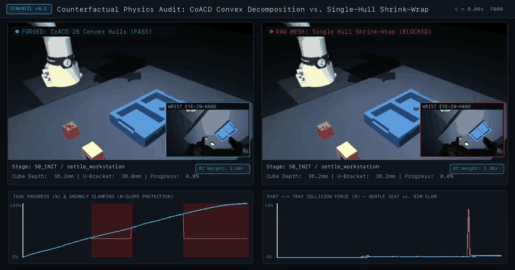
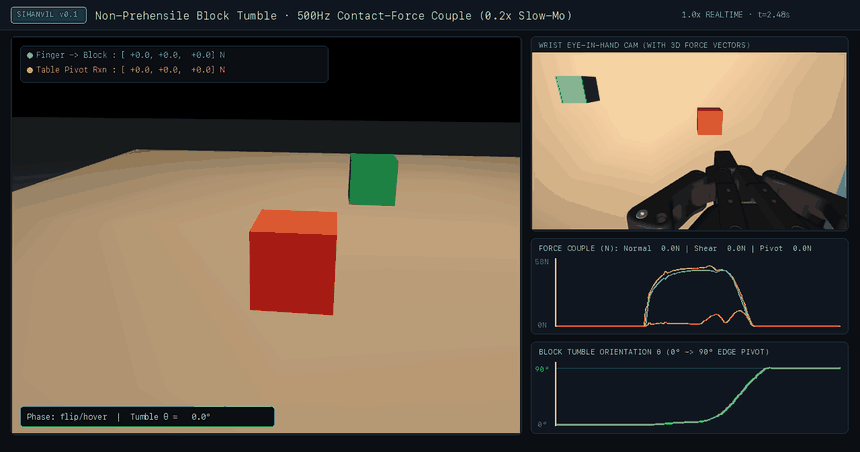
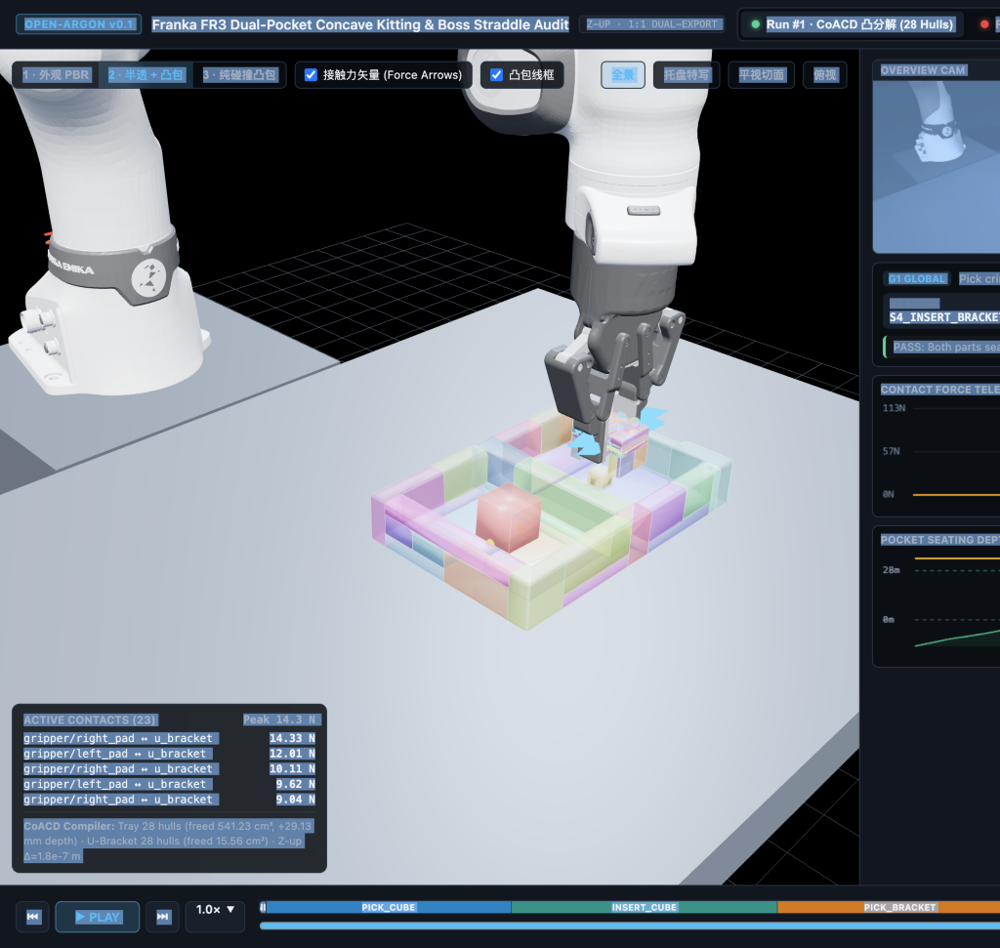
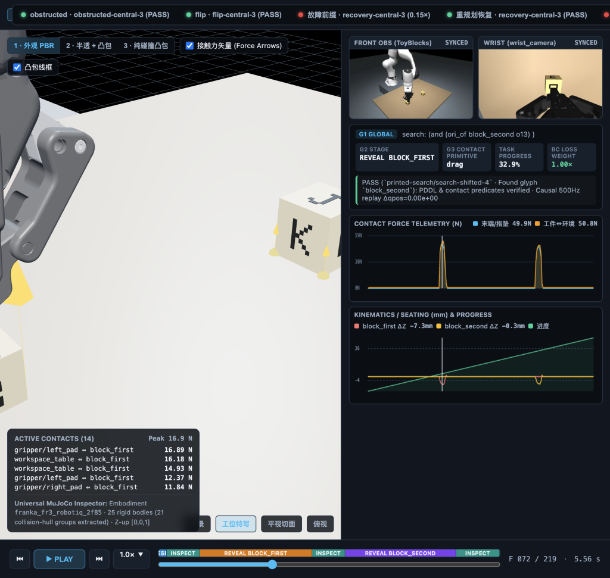

# SimAnvil

<p align="left">
  <strong>面向具身智能的数字物理铁砧 —— 锻造凹面资产、三维接触力学验尸、提纯带权重的 VLA 训练数据集。</strong>
  <br/>
  <a href="README.md">English</a> · <a href="README_zh.md">简体中文</a> · <a href="docs/assets/simanvil_showcase.mp4">凹槽配盘对比视频 (.mp4)</a> · <a href="docs/assets/toyblocks_flip_forces.mp4">500Hz 翻滚受力视频 (.mp4)</a>
</p>

> [!NOTE]
> **项目定位与交流欢迎**：`SimAnvil` 源于我个人的具身智能实验工作台，初衷是把日常折腾 MuJoCo 资产处理、接触力学排查和 VLA 造数时踩过的坑，打磨成一套**轻量、实在、开箱即用**的小工具箱。项目目前处于早期演进阶段（`v0.1`），如果你也对这套工具流感兴趣，非常欢迎提 Issue 交流想法、提功能建议或一起完善！



### 500 Hz 非抓持顶边拖动翻滚与三维接触力偶拆解（`0.2×` 慢动作回放）



---

## 为什么需要 SimAnvil？

在用 MuJoCo 为 VLA（视觉-语言-动作大模型）合成操作数据时，单看普通 RGB 录像极易漏掉 **3 个致命陷阱**：

1. **“保鲜膜陷阱”（Shrink-Wrap Trap）**：把带凹槽的托盘、碗、U 型件直接丢进 MuJoCo，默认会被单一外凸包封死洞口；且 Blender 默认导出的 Y-up `.glb` 与物理引擎 Z-up `.obj` 经常轴向错位。
2. **隐蔽的仿真作弊（Silent Reward Hacking）**：脚本表面跑通，实则依赖吸附焊接、异常高摩擦或状态瞬移，夹爪与工件接触力早已飙升到上百牛顿却无从察觉。
3. **异常片段污染训练（Poisoned Trajectories）**：打滑重试、IK 奇异报错、撞沿卡死的尾部帧若按 `1.0×` 权重喂进 `LeRobot` 会带偏策略；若整条丢弃又浪费干净前缀并破坏 Action Chunk 的时序连续性。

**`simanvil`** 采用 **“零大模型依赖的轻量物理算子核心（`src/simanvil/`）+ AI 编程助手技能层（`skills/`）”** 双栖架构，既能在无网算力集群跑批处理造数，又能挂载到 Antigravity / Claude Code / Cursor / Codex 中让多模态 Agent 自主完成“建模 → 网页验尸 → 归因改参 → 提纯导数”闭环。

---

## 零后端交互式三维物理验尸台 (`simanvil inspect`)

任意轨迹均可一键打包成免安装静态网页（原生 Z-up `[0,0,1]`、`[w,x,y,z] → [x,y,z,w]` 四元数同步、实时 `mj_contactForce` 三维力矢量箭头、`1/2/3` 外观 ↔ 彩色凸包透视切换，以及 `GOP=1` 全关键帧双路相机逐帧同步拖拽）：

| 凹面托盘与跨桥卡件（28 块彩色 CoACD 凸包 + 接触力箭头） | 非抓持指尖拖动翻面与 5×7 印刷字形检视 |
| :---: | :---: |
|  |  |

---

## 安装

```bash
# 基础核心包（Forge + Trace + Inspect —— 轻量秒装，无需安装 PyTorch）
pip install -e .

# 可选扩展：开启 LeRobot v3 带权重数据集导出与 PyAV 解码读回校验
pip install -e ".[lerobot,dev]"
```

*注：`simanvil forge` 依赖本机 Blender 4.x（默认自动探测 macOS `/Applications/Blender.app`、`PATH` 中的 `blender` 或环境变量 `BLENDER_BIN`）。*

---

## 60 秒极速上手

### 1. 运行自包含的 CoACD vs. 保鲜膜反事实对比演示

无需下载任何外部重型机器人资产：

```bash
python examples/quickstart_kitting.py
simanvil serve --dir outputs/quickstart/session --port 8895
# 浏览器打开 http://127.0.0.1:8895/index.html（快捷键：空格播放/暂停，1/2/3 切换凸包透视，F 开关力矢量）
```

### 2. 4 行代码接入已有 MuJoCo 仿真循环

`AnvilRecorder` 在物理步进中**绝不保存笨重的图像与接触力数组**，仅保存百 KB 级的 `(state, controls, phase)`，在离线导出阶段毫秒级确定性重算双机位视频与三维接触力，并自动执行 `Δqpos == 0` 纯动作因果重放校验：

```python
from pathlib import Path
from simanvil import AnvilRecorder

rec = AnvilRecorder(model, data, task="拉开抽屉并平稳推回", robot_type="my_arm", fps=25)
for step in range(500):
    rec.step(ctrl, phase="S1_PULL/pull_handle")  # 阶段名含 retry / fault 将自动触发异常标记
rec.save(Path("outputs/runs/ep_001.npz"), passed=True)
```

一行命令生成三维网页验尸台并导出带权重的 **`LeRobot v3`** 数据集：

```bash
simanvil inspect outputs/runs/ep_001.npz \
  --output outputs/session \
  --assay-out outputs/lerobot_v3
```

### 3. 在 PyTorch / VLA 训练中消费帧级 `sample_weight`

```python
per_frame_loss = criterion(pred_action, batch["action"])  # (B, ...)
weights = batch["sample_weight"].view(-1, *([1] * (per_frame_loss.ndim - 1)))
loss = (per_frame_loss * weights).sum() / weights.sum().clamp_min(1e-6)
```

---

## 底层工程不变量契约

| 核心环节 | `simanvil` 硬性工程保证 |
| :--- | :--- |
| **同源 Z-Up 微米级对齐** | 无头 Blender 统一 `ORIGIN_CENTER_OF_VOLUME` 原点，同步导出 `visual.glb` (`export_yup=False`) 与 `collision_source.obj` (`Y-forward, Z-up`)，强制断言双路包围盒误差 `< 1e-4 m`（实测 `~0.2 µm`）。 |
| **MuJoCo 标准图层号** | `group="2"` 视觉层（关闭碰撞）、`group="3"` CoACD 凸包碰撞层（开启 `condim="4"` 扭转摩擦防打滑）、`group="4"` 参考与可供性 `<site>`。 |
| **因果重放校验** | 从 `state[0]` 出发仅喂入高频 `controls` 重新积分 `mj_step`，量化核对末态 `max_abs_qpos_err`。 |
| **零延迟逐帧拖拽与原子写盘** | 审计视频采用 `PyAV` 全关键帧（`GOP=1`）H.264 编码；`LeRobot v3` 落盘前自动抽帧解码核验 `MAE < 0.05`。 |
| **零侵入外部基准适配** | 通过 `register_episode_adapter` 外挂任意第三方任务目录而无需改动核心库（示范见 [`examples/inspect_toyblocks_dir.py`](examples/inspect_toyblocks_dir.py)）。 |

---

## 演进路线图 (Roadmap)

- [x] **v0.1**：Blender Z-up + CoACD `forge`、因果录制器 `AnvilRecorder`、多模型 HTML `inspect` 审计台、带权重 `LeRobot v3` `assay` 及配套 Agent `skills/`
- [ ] **v0.2**：多部件铰接 `.glb` 自动拆件与 `<joint type="hinge|slide"/>` 合成、可选 MuJoCo 4 Filament PBR (`mjrf`) 光追渲染、`.mcap` 真机日志导入适配器
- [ ] **v0.3**：无头浏览器九宫格诊断图 CLI (`simanvil check-viewer`) 与 `mujoco_warp` GPU 批量域随机化合成接口
- [ ] **v0.4**：单图桌面场景重建工作流与真机两阶段安全空跑（Dry-Run）标定一致性校验

---

## 致谢与参考 (Acknowledgments)

`SimAnvil` 的设计深受具身智能社区优秀开源基准与工程实践的启发，在此特别致谢：

- **[AI2 ToyBlocks](https://github.com/allenai/ToyBlocks)** *(Allen Institute for AI)* —— 其声明式桌面积木操作基准、PDDL 符号几何谓词、非抓持顶边拖动翻面任务及闭环状态校验机制，直接启发了本项目的轨迹契约设计与接触力偶演示实验。
- **Google DeepMind Gemini Robotics 系列技术博客**（*Gemini 4 Argon for Robotics* 与 [*Gemini Robotics 2.5*](https://deepmind.google/blog/gemini-robotics-2-5-accelerates-real-world-physical-intelligence/)） —— 其关于接触对齐物理资产编译、免安装交互式 HTML 会话审计台（防 Reward Hacking）以及事后细粒度重标注与异常片段降权的数据飞轮理念，为本项目提供了重要的架构参考。
- 感谢底层物理仿真、几何处理与机器人学习开源生态：**[MuJoCo](https://github.com/google-deepmind/mujoco)**、**[CoACD](https://github.com/SarahWeiii/CoACD)**、**[Blender](https://www.blender.org/)** 与 **[LeRobot](https://github.com/huggingface/lerobot)**。

## 开源协议

Apache-2.0，详见 [LICENSE](LICENSE)。
